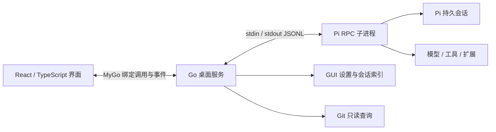

# 技术设计

状态：设计与实现并行；已完成 macOS 构建、Pi RPC 握手和一次真实模型只读任务，完整集成验收未完成。更新日期：2026-10-22。

## 当前实现与设计的对应关系

本文后续章节保留完整首期设计。当前实现只覆盖 M0/M1 的第一条功能链路，并提前接入停止和扩展弹窗等必要交互，不能把下面的设计职责全部视为已经实现。

| 模块 | 当前实现 |
| --- | --- |
| `main.go` | MyGo 窗口、单实例、开发/正式数据隔离、窗口重开与退出流程 |
| `desktop.go` | 目录选择、Pi 1.4.0 检查、项目与会话管理、模型选择、事件和快照、基础扩展交互 |
| `internal/pi/` | 标准库 RPC 客户端、ID 关联、LF 分帧、超时、清队列与停止、子进程组清理 |
| `internal/localstate/` | 设置和索引的有界 JSON 读写、私有权限、同目录原子替换与损坏文件保留 |
| `src/` | React 对话工作台、流式消息状态、工具结果、草稿、明暗主题和生成的 Go 绑定 |

当前协议记录上限为 32 MiB，发送文字上限为 1 MiB，设置文件上限为 4 MiB。UI 事件带 generation 和 sequence；消息快照记录相应边界，慢窗口通过快照重新同步，避免无界缓存堵住 stdout。

快照补充 transient 数据来恢复尚未完成的消息、活动工具和当前队列。transient 缓存上限为 16 MiB 或 16384 条记录；超过上限时明确报告暂时无法提供完整快照，等待任务结束后再刷新，不将不完整内容伪装为恢复成功。快照读取不与等待扩展输入的 Send 共用阻塞锁；此场景已有回归测试。

当前与完整设计的差距：Git 查询尚未实现；草稿使用 WebView 本地存储；未接入推理级别、用量、命令清单、图片、压缩前历史及索引自动重建；stderr 排空但尚未保留完整诊断日志。正常重启与空闲窗口重开恢复已验证；运行中窗口重开、异常退出恢复和扩展兼容仍需真机验收。实际运行步骤见 [开发指南](development.md)。

## 1. 选型与依据

| 选择 | 原因 | 已知边界 |
| --- | --- | --- |
| MyGo 桌面壳 | Go 进程管理、系统窗口与对话框、WebView 和类型化前后端调用 | 框架的平台支持与性能声明需要实测 |
| React + TypeScript Web UI | Markdown、代码和 diff 展示适合 Web 生态；减少自绘富文本实现量 | macOS 使用系统 WebView，不能假设所有 Chromium 特性可用 |
| Pi RPC 子进程 | 官方明确用于其他语言、IDE 和自定义 UI；无需重写 Agent | JSONL 协议和能力随 Pi 版本变化 |
| 本地 JSON 设置 + Pi 会话文件 | 首期数据量小，保留 Pi 原有会话语义 | GUI 索引不等同于 Pi 全部历史；暂不引入数据库 |

首期采用 MyGo WebView 路线。Go 原生 UI 不作为同步开发的第二套界面；暂不加入 Electron、Tauri 或 SDK sidecar。

当前参考 MyGo v0.6.2：其 go.mod 指定 Go 1.27.1，文档要求 macOS 12+；Web 前端开发采用 Bun。Pi 官方仓库当前 package.json 为 1.4.0，npm 方式要求 Node >=22.19.0，另有 standalone 分发，因此用户是否需要单独安装 Node 取决于实际 Pi 安装方式。M0 应记录实际使用的版本与架构并固定依赖，不能直接承诺支持所有 latest。

MyGo 小体积声明仅描述框架/应用壳，完整产品的磁盘和内存评估必须包含 Pi 与其运行时。

## 2. 结构与职责

- **前端**负责显示状态、草稿、输入和交互。不直接访问凭据，不直接发起任意本机命令。
- **Go**负责窗口与目录选择、Pi 进程、命令响应关联、事件投递、GUI 本地状态、只读 Git 查询。
- **Pi**负责模型调用、工具执行、上下文压缩、配置资源、会话文件和扩展生命周期。

按职责组织文件即可，不提前建立多层 service/repository/interface。实现时先沿用 MyGo 官方模板；只有存在独立状态与测试需求才拆模块。

前后端使用 MyGo 生成的 TypeScript 绑定；Go 对 Pi 事件采用最小解析，保留原始字段。前端只声明实际使用的协议类型并验证边界，不为了类型导入打包整个 Pi SDK。

MyGo 的服务调用各自在 goroutine 中执行，进程替换、队列操作和索引写入必须串行化或保护共享状态。生成绑定会运行 main 到 App.Run，Pi 启动和文件写入只能发生在应用就绪后的显式操作中，不能因生成代码触发真实任务。

## 3. Pi 启动与进程管理

### 启动顺序

1. 解析已保存的绝对 Pi 路径；否则通过受控路径查找。macOS 从 Finder 启动时环境与终端不同，需要允许用户选择可执行文件，并验证 npm 安装方式所需的运行时可发现。
2. 校验项目目录存在且可访问，以真实规范路径标识项目。首次运行检查 Pi 版本；不运行 shell 拼接用户路径。
3. 前端先安装事件订阅；Go 再启动 Pi 并持续读取 stdout 和 stderr。事件携带 GUI 进程 generation，旧进程事件不得写入新会话。
4. 用参数数组启动 `pi --mode rpc --session-dir <GUI项目会话目录>`，设置 CWD；恢复时追加 `--session <已记录的绝对会话路径>`。不使用 `--no-session`。
5. 按用户在 GUI 中的项目资源选择追加 `--approve` 或 `--no-approve`。显式会话目录同时避免不受信任项目的 sessionDir 设置改变 GUI 的存储位置。
6. 读取 `get_state`、`get_messages`、模型/推理级别和命令清单；根据 Pi 实际返回更新界面。必须有启动期限和可理解的错误，不等待不存在的 ready 事件。

GUI 自己保存的「加载项目资源」选择不修改 Pi 全局 trust.json。`--approve` 允许扩展和配置加载，不代表开启文件系统隔离。Pi 的上下文文件发现与受信任资源发现也不是同一条规则，不能承诺 `--no-approve` 会忽略所有项目内容。

### 单活跃进程策略

首期全应用只有一个活跃 Pi 进程。空闲时同项目切换会话可使用 `switch_session`；不同项目切换时先正常结束旧进程，再用新 CWD 启动。`new_session` / `switch_session` 返回 success 仍可能带 `cancelled: true`，只有实际成功后才更新 UI 和索引。

使用 MyGo 的 `RequestSingleInstanceLock()` 防止同一应用数据目录被多个 GUI 实例写入，重复启动唤起原窗口。开发版和正式版使用不同应用标识及数据目录，避免测试写入日常会话。

运行中不直接切换项目、会话或模型。关闭窗口与退出应用分开：关闭窗口不杀进程，真正退出按产品流程停止并清理。正常清理通过关闭 stdin 请求退出；超时再终止 GUI 启动的进程及可确认归属的子进程，不杀其他 Pi 会话。M0 必须验证子进程树回收；不能承诺撤销已执行的外部副作用。

MyGo 绑定方法的 context 会在页面导航或窗口关闭时取消。Pi 生命周期由应用级进程管理负责，不绑定到一次页面调用的 context；窗口事件发送失败也不应停止 stdout 消费。窗口关闭期间，Go 保留当前运行状态与待答扩展请求；重新打开后先恢复订阅和快照。M0 必须确认应用可在最后一个窗口关闭后继续运行。

Pi 意外退出后，终结挂起请求、显示中断状态并提供重启。恢复会话只是加载持久历史，不会重新连接已经失效的 stdin/stdout，也不能恢复未持久化的执行现场。禁止自动重发未知是否已执行的 prompt。

## 4. RPC 协议与前端状态

### 读写规则

- 每个命令使用唯一 `id`；响应按 ID 匹配，不按到达顺序。
- 按 LF 切分完整 JSON 对象，可去掉前置 CR；处理 UTF-8 分块、半条记录与一次读到多条记录。Unicode 行分隔符不是记录边界。
- stdout 只作为协议，stderr 作为诊断；两者持续消费。不能把 Go 默认 Scanner 的 64 KiB 上限直接用作消息长度上限。
- 对单记录、附件和显示缓存设置明确上限；超限时报告错误并保留可恢复状态，不静默截断 JSON。具体上限在 M0 用真实长消息与图片确定。
- 写入串行化并处理背压；UI 文本按帧合并刷新，语义事件保持顺序。前端过慢时使用受控缓存和重新获取消息快照，不丢弃完成、队列、错误或扩展请求。

### 状态与事件

| 情况 | 正确处理 |
| --- | --- |
| prompt 响应成功 | 仅代表 started / queued / handled；不代表执行完成 |
| disposition=handled | 该 prompt 可没有 run；不能无条件等 agent_settled，也不能忽略扩展独立启动的后续事件 |
| message_update | 按 contentIndex 更新内容块；toolcall_delta 不是随时可解析的完整 JSON |
| message_end | 用最终完整消息覆盖流式临时数据，避免重复追加 |
| tool_execution_* | 按 toolCallId 关联；partialResult 是否累加由工具约定决定，未知工具默认展示最近快照及最终结果 |
| queue_update | steering / followUp 是完整队列快照，以 Pi 状态为准 |
| agent_end | 仅结束一轮底层运行，仍可能重试、压缩或执行队列 |
| agent_settled | 当前会话级运行不再自动继续；区分 aborted、执行失败和正常完成 |
| compaction / retry | 显示压缩或重试状态；未知上下文估算不显示成零 |
| extension_error / 意外退出 | 展示明确错误；结束相关等待，不把连接问题伪装成模型答案 |

界面保持连接状态与运行阶段分离：连接可处于启动中/可用/断开；运行可处于空闲/提交中/执行中/等待输入/停止中。压缩、重试、工具执行作为运行子状态。工具失败不必然终结整个 Agent，不能由一张失败卡片直接将整场任务标记结束。

### 停止的准确语义

1. 本地进入停止中，暂停新的提交并处理当前扩展输入请求，避免对话框使取消流程挂起。
2. 发送 `clear_queue` 并接收返回内容，将未执行文字保存为可恢复草稿；随后发送 `abort`。
3. `abort` 响应意味着会话已空闲，同时结合 `agent_settled` 与 `get_state` 处理事件竞态；超时不能标记成功。
4. 如果 clear_queue 或 abort 失败，展示失败并提供终止当前进程选项；不把清队列失败当作队列已清空。

Pi 文档明确 `abort` 本身可能让剩余队列继续执行，因此两个命令缺一不可。二者不是原子事务：清队列之前已开始的工作和外部扩展追加的工作不保证没有副作用，界面只能承诺停止后不自动重发 GUI 保存的任务。若未来增加直接 `bash` 功能，需要另行处理 `abort_bash`，不能复用不完整的停止逻辑。

## 5. 会话与本地数据

| 数据 | 所有者与处理方式 |
| --- | --- |
| 对话、工具结果、分支和压缩记录 | Pi 的 JSONL 会话文件；GUI 不自行改写 |
| 项目、会话路径和最近使用时间 | GUI 的本地索引；从 get_state 获取真实 sessionId / sessionFile |
| 草稿、主题、面板宽度、Pi 路径 | GUI 设置；临时文件加原子替换，写入失败保留旧文件并提示 |
| 模型密钥与 OAuth | Pi 原有认证配置；GUI 不复制，不输出到日志，不读取密钥打印命令 |

macOS GUI 数据拟存于 `~/Library/Application Support/Pi GUI/`，会话按项目分目录。使用平台用户配置目录 API，避免硬编码其他系统路径。GUI 索引仅保存必要元数据，不重复存储整份聊天正文；本地文件权限限于当前用户，诊断日志不默认记录完整提示词和工具参数。

首期不实现 RPC 中不存在的 `list_sessions`。列表来自 GUI 管理的索引，恢复时由 Pi 加载对应文件；索引丢失可只读扫描 GUI 自己的会话目录重建。会话尚未落盘或文件缺失时明确标记，不能创建一个空会话冒充恢复成功。恢复聊天与恢复模型上下文区分：`get_messages` 用于当前分支上下文，必要时用 `get_entries` 重建压缩前历史，避免把其他分支显示成当前对话。

P1 导入终端会话需要验证 JSONL header 的版本、cwd 与路径，决定复制/分叉还是独占打开。Pi 可能迁移旧格式，因此旧文件加载前必须有备份策略；同一文件不能由 GUI 和 TUI 同时写入。跨项目恢复和会话 fork 都不自动移动、复制或回滚工作区文件。

## 6. 扩展兼容与内容边界

支持 `extension_ui_request` 的 select、confirm、input、editor，回复原请求 ID；处理取消、超时与失效请求。通知、状态、文本 widget、标题和编辑框预填可映射到 GUI，但不能无提示覆盖用户未发送草稿。多个对话框按顺序呈现，停止/退出能处理等待中的请求。

RPC 下 `custom()`、自定义编辑器、页眉/页脚和终端输入回调等能力不可直接使用。不承诺把任意 Pi TUI 插件渲染为 Web 组件；未知请求应显示兼容性诊断。支持的请求格式变化或回包语义不明时不猜测执行。

Markdown、工具输出和 diff 均视为不可信文本：禁用或净化原始 HTML，阻止脚本与任意嵌入内容。只加载打包的本地应用页面，不让外部 URL 在带本机权限的 WebView 中导航；外部 http/https 链接显式交给系统浏览器。远程图片默认不自动请求，本地图片只使用经过验证的附件数据。

Go 绑定暴露所需操作并校验项目/会话归属、参数和路径。Git 命令使用参数数组和 `--` 分隔路径，禁用外部 diff/textconv，不执行仓库配置的渲染程序。应用不新增通用远程命令端口，也不把项目路径校验描述为 Pi 的沙箱。

## 7. Git 修改查看

以所选项目对应的仓库为范围，读取状态与已暂存/未暂存 diff，单独呈现未跟踪文件。路径使用 NUL 分隔的 Git 输出解析，覆盖空格、中文和换行文件名。支持没有 HEAD 的新仓库；非 Git 目录显示不可用状态。

显示来源为「工作区当前变更」，包括用户和其他程序的修改；不写成「本次 Pi 修改」。不实现精确归因、自动暂存或恢复。未跟踪文件只在用户点开后按大小/类型限制读取；二进制、符号链接和超大文件显示元信息，不跟随链接读取项目外内容。

首期只在打开面板、任务结束或用户手动刷新时查询，避免立刻引入文件监控。执行仍在改文件时标记快照时间，不承诺实时一致。

## 8. 官方依据与待验证项

方案阶段查阅 Pi 默认分支，记录提交 `58c0b02ce552adab76014e7ed712ab7981359aa8`。当前代码固定 MyGo v0.6.2，并只接受本机 Pi 1.4.0；不是把这个提交构建并打包到 GUI 中。升级前需重新核对安装版本的 help、协议和模板。

| 资料 | 支撑结论 |
| --- | --- |
| [MyGo README](https://github.com/egoist/mygo/blob/v0.6.2/README.md)、[go.mod](https://github.com/egoist/mygo/blob/v0.6.2/go.mod)、[文档](https://github.com/egoist/mygo/blob/v0.6.2/docs/README.md) | WebView、平台要求、Go 版本、桌面与打包能力 |
| [MyGo 绑定](https://github.com/egoist/mygo/blob/v0.6.2/docs/bindings.md)、[应用](https://github.com/egoist/mygo/blob/v0.6.2/docs/app.md)、[分发](https://github.com/egoist/mygo/blob/v0.6.2/docs/distribution.md) | 事件、服务并发、调用 context 生命周期、单实例、生成绑定和打包 |
| [Pi RPC](https://github.com/earendil-works/pi/blob/58c0b02ce552adab76014e7ed712ab7981359aa8/packages/coding-agent/docs/rpc.md)、[命令](https://github.com/earendil-works/pi/blob/58c0b02ce552adab76014e7ed712ab7981359aa8/packages/coding-agent/docs/rpc-commands.md) | 子进程集成、命令关联、队列、停止、会话切换 |
| [Pi 事件](https://github.com/earendil-works/pi/blob/58c0b02ce552adab76014e7ed712ab7981359aa8/packages/coding-agent/docs/json.md)、[扩展 UI](https://github.com/earendil-works/pi/blob/58c0b02ce552adab76014e7ed712ab7981359aa8/packages/coding-agent/docs/rpc-extension-ui.md) | 流式重建、完成语义、工具事件、对话框与 TUI 限制 |
| [Pi CLI](https://github.com/earendil-works/pi/blob/58c0b02ce552adab76014e7ed712ab7981359aa8/packages/coding-agent/docs/cli.md)、[会话格式](https://github.com/earendil-works/pi/blob/58c0b02ce552adab76014e7ed712ab7981359aa8/packages/coding-agent/docs/session-format.md) | 启动参数、目录、持久文件与恢复 |
| [Pi 安全与信任](https://github.com/earendil-works/pi/blob/58c0b02ce552adab76014e7ed712ab7981359aa8/packages/coding-agent/docs/security.md)、[包声明](https://github.com/earendil-works/pi/blob/58c0b02ce552adab76014e7ed712ab7981359aa8/packages/coding-agent/package.json) | 项目信任、操作系统权限、运行时要求 |

已获得的本机证据：macOS Apple Silicon 构建生成约 9.4 MB `.app` 与约 2.8 MB DMG；Pi 1.4.0 RPC 握手返回会话状态与 49 个模型。桌面应用使用 Deepseek-V4.1-Flash 完成一次真实只读任务，观察到 `read` 工具读取隔离临时项目的 `sample.txt`，并正确展示两行中英文内容。

测试文件内容断言完全未变，会话工具调用记录仅有 `read`，没有 `bash`、`edit` 或 `write`。正常 `Cmd+Q` 退出成功，随后 `ps` 检查无该 GUI 与其 Pi RPC 进程残留；最新版 `bun run build` 再次成功。

最新原生应用完成正常重启恢复验证：彻底退出后重启并连接同一项目，用户消息、`read` 工具结果和完整回复均恢复，没有自动发送。空闲时关闭窗口再创建新窗口，连接、历史和未发送中文草稿均保留；测试草稿已清除。该结果仅覆盖空闲状态，不代表运行中窗口重开或停止通过。

`go test -race ./...`、`go vet ./...`、`bun test src` 和 `bun run build:web` 已通过。验证覆盖协议、状态与存储边界；运行中真实工具停止/恢复和完整原生交互仍未完成验收。

仍需实测：MyGo 对手动中文 IME/剪贴板图片/键盘焦点的表现；运行中的事件订阅与窗口重开；长对话内存；Finder 启动时 Pi 环境；真实扩展阻塞时的停止；运行中真实工具子进程退出；打包产物的完整操作流程。保留中文草稿不等于中文 IME 组合输入验收。当前无性能或生产稳定性结论。
